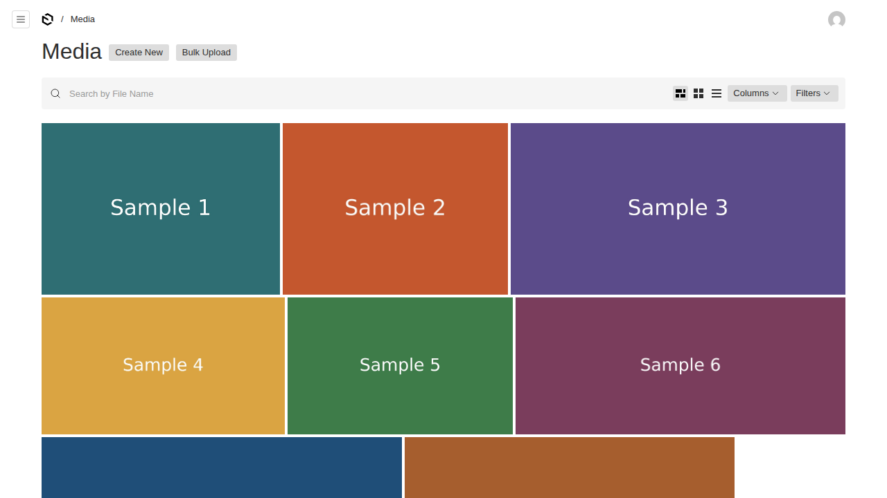

# @klnap/payload-storage-sanity

Store Payload CMS uploads in Sanity, and browse them in a media gallery inside Payload's Admin.

```ts
import { sanityStorage } from '@klnap/payload-storage-sanity'

plugins: [
  sanityStorage({
    projectId: process.env.SANITY_PROJECT_ID!,
    dataset: process.env.SANITY_DATASET!,
    token: process.env.SANITY_API_TOKEN!,
  }),
]
```

## Why?

Payload manages content, relationships, and media records. Sanity stores the files and delivers them
through its CDN, including image transformations. This plugin connects the two: Payload stays the media
workspace, and Sanity stores and serves the assets. Sanity Studio is not required.

See [asset ownership and delivery](./docs/asset-lifecycle.md) for the full model.

## Features

- Native Payload storage for image, video, and file uploads, to Sanity.
- A media gallery with justified, grid, and list layouts, plus a detail view with crop, focal point, and
  alt text.
- Deletion protection for media still used by Payload content, with a References tab.
- Optional duplicate-upload protection and upload size limits.
- Optional signed webhooks and batch reconciliation for changes made in Sanity.
- Optional Cloudflare Worker uploads that bypass the app server for browser bytes.
- Next.js `SanityImage` and framework-independent image URLs for rendering.

## Installation

```bash
bun add @klnap/payload-storage-sanity
```

```bash
npm install @klnap/payload-storage-sanity
```

## Usage

Uploads use Payload's upload input. The gallery replaces the native media list where it applies:



Choose the collections and folders to store in Sanity:

```ts
sanityStorage({
  projectId: process.env.SANITY_PROJECT_ID!,
  dataset: process.env.SANITY_DATASET!,
  token: process.env.SANITY_API_TOKEN!,
  collections: {
    media: { folder: 'website/images' },
  },
})
```

## Consumers

Render a media document in Next.js:

```tsx
import { SanityImage, type MediaAsset } from '@klnap/payload-storage-sanity/consumers/next'

export function ArticleCover({ image }: { image: MediaAsset }) {
  return <SanityImage asset={image} sizes='(max-width: 768px) 100vw, 50vw' />
}
```

Guides:

- [Storage](./docs/storage.md): collections, folders, deduplication, and size limits.
- [Media admin UI](./docs/media-admin.md): gallery, detail view, crop, focal point, and alt text.
- [References](./docs/references.md): the deletion guard and the References tab.
- [Consumers](./docs/consumers.md): Next.js, custom CDN origins, and image URLs outside Next.js.
- [Media population](./docs/media-population.md): what populated relationships return.
- [Cloudflare upload transport](./docs/cloudflare-upload-transport.md): initialize and safely deploy the optional Worker.

## Configuration

The most-used options are below. The complete list is in [configuration](./docs/configuration.md).

| Option                          | Default         | Purpose                                                     |
| ------------------------------- | --------------- | ----------------------------------------------------------- |
| `projectId`, `dataset`, `token` | required        | Sanity project, dataset, and write token.                   |
| `collections`                   | automatic       | Upload collections to store in Sanity, with folders.        |
| `admin.gallery`                 | `true`          | Use the gallery where the native list would otherwise show. |
| `dedupeUploads`                 | `false`         | Reject duplicate uploads by SHA-1 hash.                     |
| `uploadMaxSize`                 | Payload default | Upload size limit in bytes, optionally by media kind.       |
| `preventDeleteWhenReferenced`   | `true`          | Block deleting media still referenced by Payload content.   |
| `sync.enabled`                  | `false`         | Enable the Sanity webhook and reconcile endpoints.          |
| `cdnBaseUrl`                    | `cdn.sanity.io` | Origin that serves Sanity assets, for example a CDN proxy.  |

Asset access is public. Sanity CDN URLs are public for ordinary dataset assets. Read
[asset access](./docs/asset-lifecycle.md#access-and-cdn-delivery) before storing sensitive files.

## Compatibility

| Requirement                                               | Supported versions                      |
| --------------------------------------------------------- | --------------------------------------- |
| Payload, `@payloadcms/ui`, and `@payloadcms/translations` | `>=3.94.1 <4`                           |
| React and React DOM                                       | `^19.3.1`                               |
| `@sanity/client`                                          | `>=6 <9`                                |
| Next.js consumer (optional)                               | `>=16.4.5 <17`                          |
| Node.js                                                   | `^22.23.5 \|\| ^24.22.3 \|\| >=26.13.1` |

### Module format

The package is ESM only. These entries import in plain Node.js ESM, without a bundler:

- `@klnap/payload-storage-sanity` (plugin)
- `@klnap/payload-storage-sanity/consumers`
- `@klnap/payload-storage-sanity/client`
- `@klnap/payload-storage-sanity/folders`

These entries need a framework or bundler:

- `@klnap/payload-storage-sanity/consumers/next` and `/consumers/next/loader` import `next/image`, so Next.js must be
  installed. Their modules are not usable from a standalone Node.js script.
- `@klnap/payload-storage-sanity/admin` imports a stylesheet, so Node.js cannot load it directly. Payload's import map and bundler consume it.

Verified with a local build: plain `node` ESM imports succeed for the root, `/consumers`, `/client`, and `/folders`
entries. Import `/consumers/next` in a Next.js app, and `/admin` through Payload's build.

## Documentation

- [Configuration and public API](./docs/configuration.md)
- [Storage](./docs/storage.md)
- [Media admin UI](./docs/media-admin.md)
- [References and deletion guard](./docs/references.md)
- [Asset ownership, delivery, and lifecycle](./docs/asset-lifecycle.md)
- [Consumers](./docs/consumers.md)
- [Media population](./docs/media-population.md)
- [Cloudflare upload transport](./docs/cloudflare-upload-transport.md)
- [Failure semantics](./docs/FAILURE_SEMANTICS.md)
- [Troubleshooting](./docs/TROUBLESHOOTING.md)
- [Security policy](https://github.com/klnap/payload-storage-sanity/blob/main/SECURITY.md)

## License

[MIT](./LICENSE)
