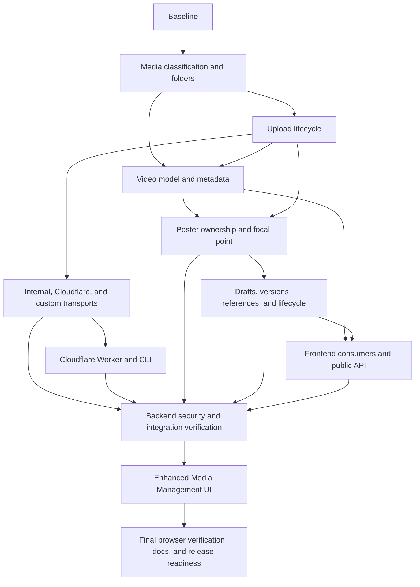

# Media platform implementation tracker

Statuses: `pending`, `in progress`, `verified`, `limited`, `blocked`,
`deferred`.
Evidence must identify an executed command, assertion, artifact, or external
record. The architecture specification is
[media-platform.md](./media-platform.md).

| Workstream | Dependencies | Status | Acceptance criteria | Verification evidence | Open risks / blocking decisions |
| --- | --- | --- | --- | --- | --- |
| Baseline and release path | None | verified | Record commit, clean tree, baseline checks, registry/release controls and package size. | `36535cda`; clean `main`; `bun run check` exit 0; npm `0.3.4`/`latest`; baseline tarball 144,430 bytes (197,806 unpacked, 16 files); no pending Changesets/open PRs at baseline; `verify` and CodeQL thresholds are required by the main ruleset; Release workflow creates a Changesets version PR and publishes only in its publish mode. | Gallery runtime performance is unmeasured because no browser fixture existed. No release PR merge or npm publication is authorized. |
| `feat/media-classification-folders` | Baseline | in progress | One classifier; four categories; full folder precedence/disabling matrix; race-safe, project-scoped folder assignment. | `bun run check` passed after classifier MIME/signature fixes; independent review found no material issue; commit `5e62057` is ready for its feature PR. Poster-folder configuration stays out until poster roles are wired. | Verify Sanity folder schema/revisions and metadata preservation in later integration checks. |
| `refactor/upload-lifecycle` | Classification/folders | pending | Extract one transport-independent finalization path; keep internal uploads as default; preserve Payload hooks, metadata, folder assignment, dedupe, and failure behavior. | Not run. Installed Payload 3.94.1 cloud-storage hooks skip `handleUpload` for files with `clientUploadContext`; lifecycle must explicitly finalize those uploads rather than assume the adapter hook runs. | Verify transactions, retries, drafts, versions, REST, Local API, and failure semantics. |
| `feat/upload-transports` | Upload lifecycle | pending | Internal transport remains default; define the public transport interface; support opt-in Cloudflare and independently authored custom transports with operation-bound tickets and receipts. | Not run. | Replay prevention and finalization require database-enforced uniqueness and a Payload transaction. |
| `feat/cloudflare-worker-cli` | Upload transports | pending | Stream bounded bytes to the fixed Sanity target; verify signed tickets and return signed receipts; provide non-destructive CLI scaffold and packed Worker build. | Not run. | Live Cloudflare/Sanity verification requires disposable credentials and explicit deployment authorization. |
| `feat/video-media-model` | Classification/folders; upload lifecycle | pending | Add video media type and metadata without inferring playback support from MIME alone. | Not run. | Verify Sanity metadata and Payload field persistence. |
| `feat/video-poster-lifecycle` | Video media model; upload lifecycle | pending | Persist poster ownership within the video document; use confirmed frames and shared focal coordinates; clean up only proven-exclusive obsolete assets. | Not run. | Retain assets when cross-system references or deletion safety cannot be proven. |
| `feat/media-editorial-lifecycle` | Poster lifecycle | pending | Preserve draft/version behavior, references, and crop semantics through media replacement and poster updates. | Not run. | Verify Payload transactions and version snapshots under failure and retry. |
| `feat/video-consumers` | Video media model; editorial lifecycle | pending | Expose canonical `MediaAsset` and framework-safe image/video consumers through the public API. | Not run. | Verify existing mappings, supported Next.js versions, and packed consumers. |
| Security review and integration verification | Upload transports; Worker; poster lifecycle; editorial lifecycle; consumers | pending | Independently review authorization, tickets, replay, SSRF, paths, tenant isolation, cleanup, and secrets; run backend integration tests. | Baseline: five historical CodeQL alerts are fixed; no open alerts. Main ruleset requires CodeQL with `high_or_higher` security-alert and `errors` code-scanning thresholds. Private vulnerability reporting, secret scanning, push protection, and SHA-pinned Actions are enabled. | Dependency-update automation remains unconfirmed; recheck after implementation. |
| `feat/enhanced-media-management-ui` | Backend workstreams verified | deferred | Build gallery, stable sidebar behavior, media detail views, type indicators, video previews/player, poster timeline/frame selection, and focal-point editing without regressing existing admin behavior. | The isolated gallery fixture reported no overlap or viewport overflow under sidebar toggles and resizing; no layout-source fix was justified. Existing gallery worktree changes remain uncommitted and are preserved. | Defer all visual/UI optimization until phases 1–9 are complete. |
| Final browser verification, documentation, and release readiness | Enhanced UI; all backend workstreams | pending | Verify browser workflows and packed consumers; update docs only for shipped behavior; preserve `0.x` release controls. | No final browser or packed-consumer evidence exists for this initiative. | No release PR merge or npm publication is authorized. |

## Dependency graph

## Branch plan

Merge each focused feature branch before starting branches that depend on it.
Start branches from the updated `origin/main`; preserve the existing isolated
gallery worktree and resume it only in the enhanced-UI phase. Do not publish or
merge a release PR as part of implementation.

1. Finish and PR `feat/media-classification-folders`.
2. Implement and PR `refactor/upload-lifecycle`.
3. Implement and PR `feat/upload-transports`, then `feat/cloudflare-worker-cli`.
4. Implement and PR `feat/video-media-model`, then
   `feat/video-poster-lifecycle` and `feat/media-editorial-lifecycle`.
5. Implement and PR `feat/video-consumers`.
6. Complete independent backend security and integration verification.
7. Resume `fix/admin-gallery-layout` and deliver
   `feat/enhanced-media-management-ui`.
8. Run final browser, documentation, packed-consumer, and release-readiness
   checks without publishing.
