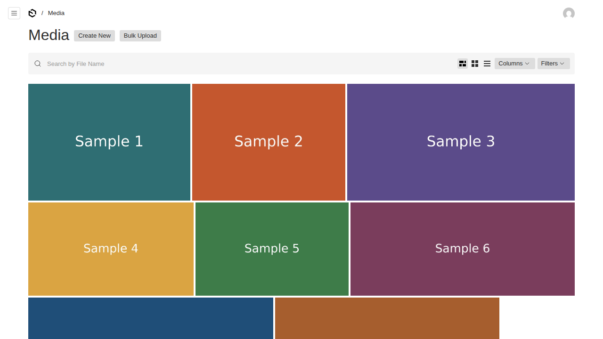
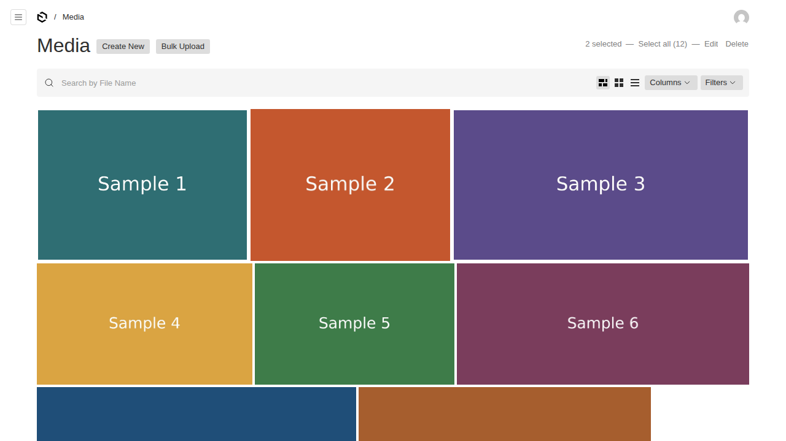
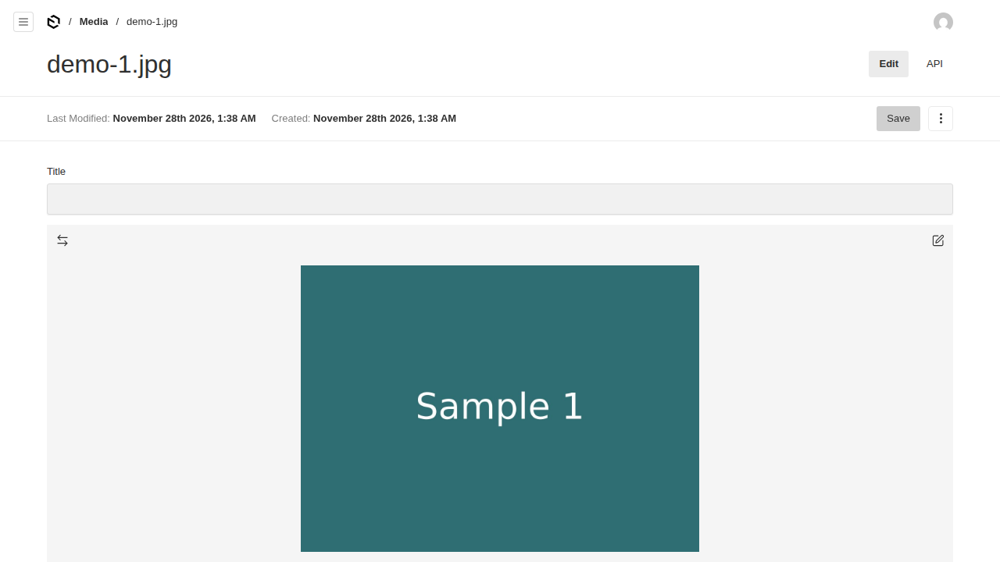

# Media admin UI

The plugin adds a media gallery and detail view to Payload's Admin. Uploads, navigation, and
permissions stay Payload's own.

## Gallery



The gallery replaces Payload's media list for collections that use it. A collection with its own list
view keeps that view.

- **Justified:** rows keep each image's aspect ratio, up to 2.5:1. Wider panoramas use a 2.5:1 tile and
  show the image letterboxed inside it.
- **Grid:** equal tiles with `object-fit: cover`.
- **List:** Payload's native table.
- **Other files:** file-type artwork with the filename visible.
- **Selection and bulk actions:** Payload's row selection stays available. Selection drawers support it
  when Payload provides the callbacks.



- **Native controls:** Payload's search, filter, and column controls stay around the gallery.

The gallery does not add an uploader. Uploads use Payload's native upload input. It is enabled by
default where it applies:

- `admin.gallery: false` keeps the native list for all collections.
- `collections.<slug>.admin.gallery` overrides it for one collection.

The gallery appears in supported selection drawers, not in upload or create drawers.

## Detail view



Opening a media document shows:

- A larger preview. Images show a blur placeholder when one is available.
- Dimensions and aspect ratio when available.
- For other files, Payload's file card: icon, filename, URL, size, and MIME type.
- An **Asset** tab with the editable title and alt text, Payload's upload and replacement controls, and
  the Sanity asset details.
- A **References** tab that lists where the asset is used. See [References](./references.md).

The plugin adds no separate Metadata tab. Sanity asset data stays in the hidden, read-only `sanity.asset`
field.

## Upload feedback

While a save sends bytes to storage, the main content area becomes `inert` and `aria-busy`, so editors
cannot change fields during the upload. An upload toast shows progress. Payload's save and error
handling stay in place. Set `admin.uploadBusyShield: false` to turn this off for a collection.

## Crop

The plugin does not use Sanity's non-destructive crop metadata. It applies Payload's crop to the image
bytes, uploads the cropped result as a new Sanity asset, and points the existing media document at it.

This is deliberate: the cropped version becomes the canonical image of that media document. CDN
transformations cannot restore pixels removed by the crop.

Physical cropping needs Payload's `sharp` dependency:

```ts
import sharp from 'sharp'

export default buildConfig({
  sharp,
  // ...
})
```

Cropping does not delete the uncropped asset or revoke its URL. See [asset lifecycle](./asset-lifecycle.md).

## Focal point

Focal point is non-destructive. Editors set it in Payload's focal-point control. It is stored in `focalX`
and `focalY`, and changing it does not upload the image again.

`SanityImage` applies the coordinates as CSS `object-position` with `object-fit: cover`.
`buildSanityImageUrl()` does not read them. Use focal point to frame an image; use crop to remove pixels.

Crop and focal-point controls are on by default. Turn either off per collection through Payload's upload
options:

```ts
{
  slug: 'media',
  upload: {
    crop: false,
    focalPoint: false,
  },
}
```

## Editorial metadata

Unless the collection already defines them, the plugin adds:

- An editable **title** field.
- An **alt** field. Without Payload localization it is one field; with localization it is a locale group.

```ts
collections: {
  media: {
    alt: { required: true },
  },
}
```

`alt.required` requires non-empty alt text in each locale. `alt.enabled: false` skips the plugin's alt
field. An existing `alt` field in the collection takes precedence.

Populated responses include alt text for the request locale. Use it for ``. `alt=""` marks an
image as decorative.
